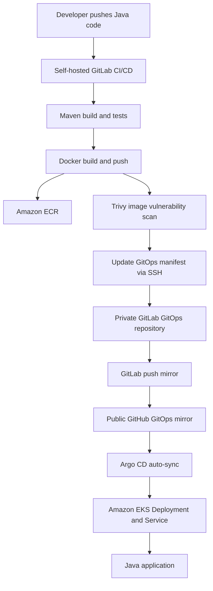

# End-to-End Java CI/CD and GitOps on AWS EKS

[](#cicd-pipeline) [](#gitops-deployment) [](#technology-stack) [](#container-security)

A hands-on DevOps project that automates the build, test, containerization, security scanning, and deployment of a Java application to **Amazon EKS**. A self-hosted GitLab CI/CD pipeline builds and publishes versioned images to **Amazon ECR**, updates a separate GitOps repository over SSH, and triggers **Argo CD** to reconcile the Kubernetes cluster from Git.

The workflow was validated end-to-end by accessing the updated application in a browser. **Argo CD self-healing and Git-based rollback were also tested successfully.**

> **Portfolio note:** This README intentionally omits private GitLab addresses, AWS account identifiers, cluster names, credentials, and internal networking details. Replace placeholders with public-safe links before publishing.

## Architecture



**Why the GitHub mirror?** The EKS-hosted Argo CD instance could not directly reach the private, office-hosted GitLab server. GitLab push mirroring makes the Kubernetes manifests available to Argo CD through a GitHub repository. The CI job uses a dedicated SSH key to update the original GitLab GitOps repository.

## Technology stack

| Area | Technologies |
| --- | --- |
| Application | Java, Maven |
| Source control and CI/CD | Self-hosted GitLab, GitLab Runner (Docker executor) |
| Containers | Docker, Amazon ECR |
| Container security | Trivy |
| GitOps | GitLab GitOps repository, GitHub push mirror, Argo CD |
| Orchestration | Kubernetes, Amazon EKS |
| Authentication | SSH deploy key, protected CI/CD variables, AWS IAM credentials |

## Repository layout

The solution uses **two logical repositories**:

**1. Java application repository (self-hosted GitLab)**

```text
java-application/
├── src/
├── pom.xml
├── Dockerfile
└── .gitlab-ci.yml
```

**2. GitOps repository (GitLab, mirrored to GitHub)**

```text
java-demo-gitops/
└── k8s/
    ├── deployment.yaml
    ├── service.yaml
    └── kustomization.yaml
```

The GitOps repository stores the **actual immutable ECR image reference**, including the commit-based tag. It does **not** contain unexpanded GitLab CI variable placeholders.

## CI/CD pipeline

| Stage | Job | Purpose |
| --- | --- | --- |
| `build` | `build_java` | Compile and package the Java application using Maven; publish JAR artifact |
| `test` | `test_java` | Run Maven tests |
| `publish` | `docker_build_push` | Build Docker image, tag with `$CI_COMMIT_SHORT_SHA`, and push to ECR |
| `security` | `trivy_scan` | Scan the built image for HIGH and CRITICAL vulnerabilities and save a report |
| `update-gitops` | `update_gitops` | Update the image tag in the GitOps Deployment manifest and push via SSH |

The GitOps update job depends on the Trivy job completing successfully. **A completed scan is not automatically a vulnerability-enforcement gate:** Trivy's `--exit-code 0` reports findings without failing the job; `--exit-code 1` can block the GitOps update when matching vulnerabilities are found. Set the policy deliberately based on your security requirements.

### Image versioning

Each image is tagged with the source commit's short SHA, making it straightforward to associate an image with a specific build:

```text
<account-id>.dkr.ecr.<region>.amazonaws.com/<repository>:<commit-short-sha>
```

The CI pipeline updates only the image reference in `k8s/deployment.yaml`, commits the manifest change, and pushes it to the GitOps repository.

## GitOps deployment

1. A developer commits a Java application change to the protected source branch.
2. GitLab CI builds and tests the application, then builds and pushes a Docker image to ECR.
3. Trivy scans the image and publishes its report as a CI artifact.
4. The GitOps update job connects to the private GitLab repository using SSH and commits the new image tag.
5. GitLab mirrors the GitOps commit to GitHub.
6. Argo CD detects the desired-state change and automatically syncs the Kubernetes Deployment on EKS.
7. The updated application is verified through its browser-accessible endpoint (`/user`).

### Self-healing — verified

With Argo CD automated sync and `selfHeal` enabled, a manual change to the live Deployment replica count was automatically reconciled back to the count declared in Git. This demonstrates configuration-drift correction.

### Git-based rollback — verified

A previous working image tag was restored in the GitOps Deployment manifest and committed to Git. After mirroring and Argo CD synchronization, the earlier application version was restored and verified. **Rollback was performed through Git**, rather than relying on a manual `kubectl rollout undo` that could conflict with the desired state.

## Container security

Trivy runs as a separate GitLab CI job after image publishing. The scan targets HIGH and CRITICAL vulnerabilities and creates a downloadable `trivy-report.txt` artifact.

Example scan command:

```sh
trivy image --image-src docker --scanners vuln --severity HIGH,CRITICAL --timeout 90m --exit-code 0 --format table --output trivy-report.txt "$IMAGE_URI"
```

The project encountered a slow vulnerability-database download and a malformed multiline command during integration. The scan was stabilized by increasing the timeout, caching Trivy data, and using a single-line invocation.

> **Deployment gate configuration:** The tested scan pipeline completed successfully. To enforce a vulnerability-based gate, change `--exit-code 0` to `--exit-code 1` and validate the expected failure behavior. This README does not claim that enforcement has been tested.

## CI/CD and access security

- Protected source branch and protected GitLab CI/CD variables.
- Dedicated SSH key for CI-to-GitOps Git operations; no Git access token transmitted over plain HTTP.
- Verified SSH host-key material used by CI to validate the GitLab server identity.
- Repository-scoped write access should be granted only where required.
- AWS IAM permissions should be limited to required ECR operations and resources.
- Docker socket access is sensitive: the self-hosted Docker executor should run only trusted pipelines on an appropriately isolated runner.
- No credentials, private SSH keys, or internal-only addresses are included in this public documentation.

## Verification commands

Replace the placeholders with the resource names used in your environment.

```sh
# Confirm the image currently specified by the Deployment
kubectl get deployment java-demo -n java-demo-gitops \
  -o jsonpath='{.spec.template.spec.containers[0].image}'

# Check rollout completion
kubectl rollout status deployment/java-demo -n java-demo-gitops

# Inspect running Pods
kubectl get pods -n java-demo-gitops

# Check Argo CD Application sync and health
kubectl get application java-demo -n argocd
```

## Challenges and lessons learned

| Challenge | Resolution / learning |
| --- | --- |
| Argo CD could not reach private office GitLab | Configured GitLab-to-GitHub push mirroring and pointed Argo CD at GitHub |
| GitLab did not support HTTPS | Used SSH authentication for CI Git operations instead of sending access tokens over HTTP |
| CI SSH private key failed to parse (`libcrypto`) | Corrected CI file-variable key formatting and line endings |
| Trivy vulnerability DB download timed out | Increased timeout and configured a reusable cache |
| Trivy command failed with “Require at least 1 argument” | Simplified command formatting so the image reference is passed correctly |
| Manual Kubernetes changes caused configuration drift | Enabled and tested Argo CD self-healing |
| Need to recover a prior application version | Restored the earlier image tag through a GitOps commit |

## Suggested screenshots

Added sanitized screenshots under `docs/images/` and linked them here:

1. GitLab pipeline with all five stages passing.
   
2. Trivy scan job and vulnerability-report artifact (redact account IDs and private URLs).
3. Argo CD Application showing `Synced` and `Healthy`.
   
4. Kubernetes Deployment and Pods after reconciliation.
5. Application response in the browser after deployment.
6. GitOps commit history showing an image update and rollback.
   
   

## Project outcomes

- Built a working Java application CI/CD pipeline with Maven, Docker, GitLab Runner, and ECR.
- Automated Kubernetes image updates through a separate GitOps repository.
- Integrated GitLab-to-GitHub mirroring to bridge network reachability constraints.
- Deployed changes automatically to EKS using Argo CD.
- Verified application updates, configuration self-healing, and Git-based rollback.
- Integrated Trivy vulnerability reporting and applied CI/CD credential and branch protections.

## Further improvements

- Enforce and test a vulnerability-based Trivy deployment gate (`--exit-code 1`).
- Prefer short-lived AWS credentials where supported and further restrict ECR IAM policies.
- Isolate Docker socket access and restrict runner execution to trusted code.
- Add automated integration tests, policy checks, and monitoring as future enhancements.

---

**Status:** End-to-end deployment, Trivy scanning, self-healing, and Git-based rollback have been successfully exercised. This is a learning and portfolio implementation; production deployment would require environment-specific security, availability, and operational reviews.
